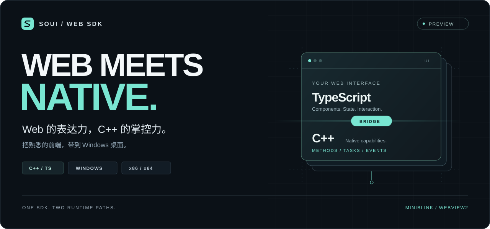
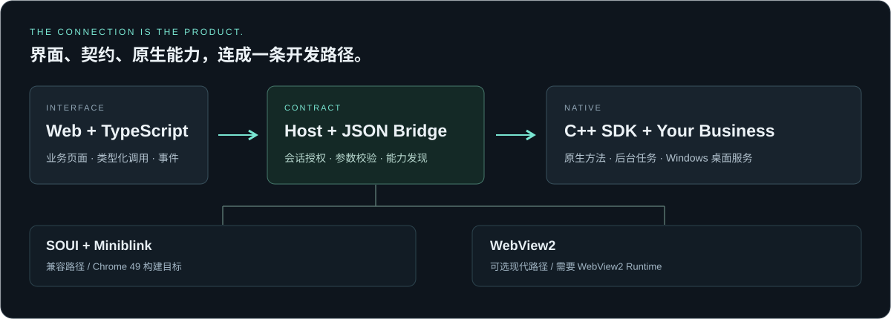
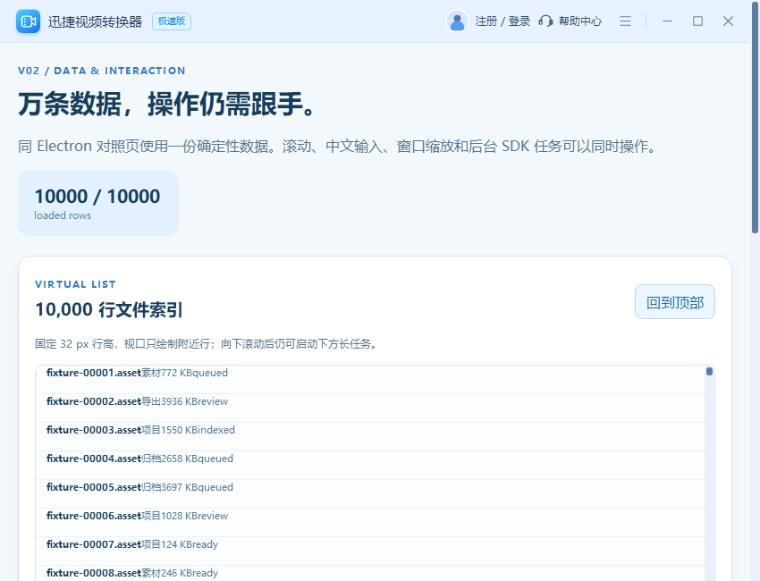

<p align="center">
  
</p>

<h1 align="center">SOUI Web SDK</h1>

<p align="center">
  <strong>用熟悉的 Web 技术构建界面，用 C++ 接住真正的桌面能力。</strong><br>
  Windows 桌面 SDK · 类型化桥接 · 双后端路径 · 可独立构建的源码交付
</p>

<p align="center">
  <a href="docs/known-issues.md"></a>
  <a href="docs/build.md"></a>
  <a href="docs/api.md"></a>
  <a href="sdk/web"></a>
</p>

<p align="center">
  <a href="#quick-start"><strong>快速上手</strong></a> ·
  <a href="#capabilities">核心能力</a> ·
  <a href="#preview">界面预览</a> ·
  <a href="#docs">文档</a> ·
  <a href="https://github.com/chenziyang110/soui-web-sdk/releases/tag/v0.5.0">下载 0.5.0</a> ·
  <a href="https://github.com/chenziyang110/soui-web-sdk/issues">反馈建议</a>
</p>

---

让前端负责界面与交互，让 C++ 负责本地业务与系统集成。SOUI Web SDK 将两者连接为一套 Windows 桌面开发工具：公共 SDK、应用模板、Workbench 演示、固定依赖，以及从构建到升级回退的配套工具。

适合已有 C++ 业务需要 Web 界面的团队，也适合需要本地任务、文件处理或原生桌面集成的前端开发者。

> **当前版本：`0.5.0`（预发布交付）**，以 [VERSION](VERSION) 为准。下载与本轮实际验证范围见 [0.5.0 发布说明](docs/releases/0.5.0.md)。完整生产验收尚未完成，`releaseReady=false`；详情见[已知限制](docs/known-issues.md)，使用与再分发条件见[许可说明](LICENSE.md)。

开发分支新增显式 [跨平台 Runtime](docs/cross-platform.md)：无窗口的任务、权限、
Bridge 协议和文件扫描可独立构建为 `Soui::Runtime`，覆盖 Windows/Linux
x86/x64/ARM32/ARM64 与 macOS x64/ARM64/universal2 的目标策略。
Linux/macOS 桌面窗口后端和其余目标机实测仍待完成；现有下载包不含此功能。

<a id="capabilities"></a>

## 从一个界面，到一整个桌面应用

| 你想做的事 | SDK 提供的起点 |
| :--- | :--- |
| **用 Web 写界面** | TypeScript 客户端与 React 应用模板；可选 React / Vue GUI 语义绑定。按运行档位选择前端构建目标。 |
| **调用已有 C++ 业务** | 通过 JSON Bridge 注册方法，类型化调用、事件订阅与能力发现沿用同一条连接。 |
| **处理耗时工作** | 公共任务服务提供启动、进度、查询与协作式取消，让耗时工作进入后台任务。 |
| **连接 Windows 桌面** | 按需接入窗口控制、目录选择、剪贴板、托盘、菜单与全局快捷键。 |
| **让动作有明确契约** | 从动作 schema 生成 C++ / TypeScript、工具描述与文档；原生端检查授权、输入和结果。 |
| **接入自动化与辅助功能** | 显式启用本地 Agent 端点与可选 Windows UIA；由应用控制能力开放、业务授权与公开界面投影。 |
| **把工程带走继续开发** | 生成独立业务项目，以 `sdk-lock.json` 固定 SDK；配套构建、安装、升级、回退与恢复工具。 |

功能范围与前置条件见 [API 文档](docs/api.md)。Workbench 中的媒体、扫描等业务适配器属于演示层；公共 SDK 与 Demo 分层维护。

<p align="center">
  
</p>

## 一套 SDK，两条运行路径

| | 兼容路径 | 现代路径 |
| :--- | :--- | :--- |
| **宿主 / 渲染** | SOUI + Miniblink | 可选 `Soui::WebView2` |
| **应用模板** | [`desktop-app`](templates/desktop-app) | [`modern-app`](templates/modern-app) |
| **前端构建目标** | Chrome 49，包含兼容转换 | Chrome 120，启动时检查所需能力 |
| **使用方向** | 需要保留旧系统目标的 Windows 应用 | 面向受支持 Windows 10 / 11 环境的现代 Web 界面 |
| **运行依赖** | 随应用部署固定 DLL 与资源 | WebView2 Runtime 与应用资源 |
| **创建选项** | 默认，或 `-Profile compatibility` | `-Profile modern` |

两条路径共享公共 Host / Bridge 接口，前端分别构建。最终用户运行应用无需安装 Node.js。具体系统、驱动、输入法及 PE 环境仍需独立验收；现代路径需要实际可用的 WebView2 Runtime。详见[现代后端与运行档位](docs/modern-backend.md)。

<a id="quick-start"></a>

## 开始构建你的桌面应用

想先体验？[0.5.0 Release](https://github.com/chenziyang110/soui-web-sdk/releases/tag/v0.5.0) 提供兼容模板、Modern 模板和 Workbench 的 x86 / x64 应用 ZIP，以及源码包与 SHA-256；Modern 应用需要 WebView2 Runtime。

0.5 的公共 C++ 布局与关闭接口有变化。源码接入请使用整套 SDK、对应内核并重新编译应用；缺少关闭接口的历史 DLL 会在初始化前返回依赖错误。升级方式见[版本文档](docs/versioning.md)，显式 LLVM 构建见[构建文档](docs/build.md)。

**开发环境**：Windows x64、Visual Studio 2022 C++ 桌面开发组件及 ATL、Windows SDK `10.0.19041.0`、CMake `3.24+`。完整仓库与现代模板使用 Node.js `22.12+`；基础 SDK 和兼容生成项目保留 Node.js `20.19` 支持。先取得本仓库源码，以下命令从 **SDK 仓库根目录**执行。

### 1. 检查环境，构建 SDK 与演示

```powershell
powershell.exe -NoProfile -ExecutionPolicy Bypass `
  -File tools/Doctor.ps1
powershell.exe -NoProfile -ExecutionPolicy Bypass `
  -File tools/Build.ps1 -Architecture x64 -Configuration Release -Install
```

构建会安装锁文件约束的 Web 依赖、编译 SDK / 模板 / Workbench，并部署运行文件。首次获取依赖需要网络或预备缓存。

```powershell
# 启动 Workbench
.\out\x64\bin\Release\SouiWorkbench\SouiWorkbench.exe
```

### 2. 从模板创建独立项目

```powershell
powershell.exe -NoProfile -ExecutionPolicy Bypass `
  -File tools/New-Project.ps1 -Name MyDesktopApp `
  -OutputRoot ..\MyDesktopApp
Push-Location ..\MyDesktopApp
powershell.exe -NoProfile -ExecutionPolicy Bypass `
  -File tools/Build.ps1 -Architecture x64
.\out\x64\bin\Release\MyDesktopApp\MyDesktopApp.exe
Pop-Location
```

`OutputRoot` 必须是 SDK 目录外的新目录。接下来主要编辑 `app/`、`web/`、`contracts/` 和 `resources/`；固定 SDK 内容由 `sdk-lock.json` 管理。完整流程见[接入与业务开发](docs/getting-started.md)。

<details>
<summary><strong>使用 WebView2 现代模板</strong></summary>

先在开发机安装受支持的 WebView2 Runtime，然后从 SDK 仓库根目录执行：

```powershell
powershell.exe -NoProfile -ExecutionPolicy Bypass `
  -File tools/Build.ps1 -Architecture x64 -WithWebView2 -Install
powershell.exe -NoProfile -ExecutionPolicy Bypass `
  -File tools/New-Project.ps1 -Name MyModernApp `
  -OutputRoot ..\MyModernApp -Profile modern
Push-Location ..\MyModernApp
powershell.exe -NoProfile -ExecutionPolicy Bypass `
  -File tools/Build.ps1 -Architecture x64
.\out\x64\bin\Release\MyModernApp\MyModernApp.exe
Pop-Location
```

WebView2 SDK 由构建工具按固定身份恢复；最终用户机器上的 WebView2 Runtime 需要单独准备。离线部署、Fixed Runtime 和初始化契约见[现代后端文档](docs/modern-backend.md)。

</details>

## 让页面真正调用 C++

下面的片段使用模板已经注册的 `app.greet` 动作。在生成项目的 `web/src/` 中调用：

```ts
import { connectNative } from './native';
import { callAction } from './generated/actions';

async function greet() {
  const client = await connectNative();
  const result = await callAction(client, 'app.greet', { name: 'Developer' });
  console.log(result.message);
  // Hello, Developer. This response came from C++.
}

void greet();
```

在模板的 C++ 初始化代码中，对应处理器通过生成的类型注册：

```cpp
app_actions::register_Greet(bridge,
    [](const app_actions::GreetInput& input,
       const soui::runtime::bridge_request&) {
        return app_actions::GreetOutput{
            "Hello, " + input.name + ". This response came from C++."
        };
    });
```

`contracts/actions.json` 是动作定义的来源；生成器产出两端代码和描述，构建会检查生成结果是否过期。页面需要从桌面宿主启动才能连接原生服务。完整上下文见[模板](templates/desktop-app/README.md)与 [API](docs/api.md)。

### 为可发现、可校验的动作而设计

`discover()` 读取当前会话获授权的能力；动作 schema 定义输入与结果；GUI 语义接口为应用显式注册的控件提供 `snapshot`、`perform` 和 `waitFor`。可选 [React / Vue 绑定](docs/gui-bindings.md)帮助把这些语义接入组件。

0.5 提供显式启用的 Windows 本地 Agent 端点与可选 `Soui::Uia` 组件。应用配置允许的调用主体、能力与动作，分别处理页面、本地 Agent 和辅助功能授权；页面 GUI 注册不会自动开放这些入口。接口与生命周期见 [API 文档](docs/api.md)，实际验收边界见 [0.5 执行清单](docs/roadmap/0.5.0-execution.md)。

<a id="preview"></a>

## 看看界面，也看看连接背后的能力

[Workbench](demos/workbench/README.md) 包含媒体工具界面、文件扫描、组件展示，以及万行列表与后台任务的交互场景。构建后可直接打开数据演示页：

```powershell
.\out\x64\bin\Release\SouiWorkbench\SouiWorkbench.exe --react --page=data
```

<details>
<summary><strong>展开真实 Workbench 窗口截图</strong> · 历史界面记录</summary>

<p align="center">
  
</p>

截图来自 [2026-09-29 的 x64 Release 窗口记录](verification/production-validation/scrollbar-style-modern-2026-09-29/README.md)，用于展示历史 Demo 外观。图中文字与示例品牌属于演示页面，不能作为当前版本的性能、兼容性或品牌背书。

</details>

## 从源码到交付，都有入口

```text
soui-sdk/
├─ sdk/                       C++ / TypeScript 公共 SDK
├─ templates/
│  ├─ desktop-app/            兼容应用模板
│  └─ modern-app/             WebView2 现代模板
├─ demos/workbench/           完整场景演示与业务适配器
├─ third_party/               固定依赖、底层源码与授权材料
├─ cmake/                     应用接入与运行资源部署
├─ tools/                     检查、生成、构建、测试、打包
├─ tests/                     协议、安装与独立接入测试
├─ docs/                      接入、架构、API 与维护文档
└─ verification/              按版本和构建保存的验收记录
```

<details>
<summary><strong>更多构建与验证命令</strong></summary>

从 SDK 仓库根目录执行，按需要选择入口：

```powershell
# 只编译并安装 SDK
powershell.exe -File tools/Build.ps1 -SdkOnly -Architecture x64 -Install

# 执行适用的本机验证
powershell.exe -File tools/Test.ps1 -Architecture x64 -Configuration Release

# 使用随包源码重新编译底层依赖（耗时和空间需求较大）
powershell.exe -File tools/Build-Dependencies.ps1 -Architecture x64 -Component All
```

32 位构建使用 `-Architecture x86`；Debug 使用 `-Configuration Debug`。模板与 Demo 默认位于 `out/<架构>/bin/<配置>/`，安装后的 C++ SDK 位于 `out/install/<架构>/`。分发应用时复制完整应用目录及 DLL / `resources`，不能仅复制 EXE。参见[完整构建](docs/build.md)、[测试与验收](docs/testing.md)、[版本升级与回退](docs/versioning.md)。

</details>

<a id="docs"></a>

## 继续探索

| 开始开发 | 深入 SDK | 交付与维护 |
| :--- | :--- | :--- |
| [接入与业务开发](docs/getting-started.md) | [C++ / Web API](docs/api.md) | [测试与验收](docs/testing.md) |
| [现代后端与运行档位](docs/modern-backend.md) | [架构与目录所有权](docs/architecture.md) | [版本、升级与回退](docs/versioning.md) |
| [构建与底层源码](docs/build.md) | [React / Vue GUI 绑定](docs/gui-bindings.md) | [发布与打包](docs/releasing.md) |
| [Workbench 演示](demos/workbench/README.md) | [GUI 与 Agent 路线](docs/roadmap/agent-gui-framework.md) | [故障排查](docs/troubleshooting.md) |

<details>
<summary><strong>维护、历史验收与高级构建入口</strong></summary>

- [私有存储请求的独立读端解释（ADR-0082）](docs/adr/0082-task-store-private-storage-readers.md)：Source 与纯 JS；真实长期采集和完整缓存预算仍待验证。
- [TaskStore 空存储清理的退款记账（ADR-0081）](docs/adr/0081-task-store-empty-deallocation-accounting.md)：独立 x86 fault 回归已通过；完整 SDK 与 x64 回归仍待验证。
- [生产验证记录](docs/acceptance/progress.md) · [0.4 执行清单](docs/roadmap/0.4.0.md) · [0.3 迭代计划](docs/roadmap/0.3.0.md)
- [0.3 基础切片](docs/roadmap/0.3-foundation.md) · [0.3 生产验证方案](docs/roadmap/0.3-sdk-validation.md) · [WebView2 独立消费者](experiments/webview2-consumer/README.md)

### Explicit host AMD64 build observation

The standard LLVM caller has an opt-in `--host64-build-observer` mode described
in [ADR-0083](docs/adr/0083-host64-build-debug-observer.md). It preserves the
original build and semantic gates and keeps the original polling diagnostics.
The observer is a separate host AMD64/Windows 8+ helper; it does not change the
SDK output architecture or establish Windows 7 compatibility.

`tools/internal/Prepare-Host64BuildObserver.ps1` defaults to a read-only plan.
It requires explicit `ProfileRequestFile` (prepared host x64 LLVM request),
`DevkitRoot`, `CMakeExe`, `NodeExe` and a fresh `OutputDirectory`. A separate
explicit `-Prepare` operation creates the actual producer receipt. Standard
build requires `--host64-observer-prepared` with that receipt's absolute path
and `--host64-observer-sha256` with its actual SHA, as well as the existing six
explicit LLVM paths. It never automatically compiles or replaces the helper.

This portable integration currently has Source/pure verification only. Real
producer, normal x86/x64 builds, installed consumers and runtime checks remain
pending; the earlier isolated SDKOnly experiment is not their acceptance.

</details>

### 当前边界

当前 `0.5.0` 为预发布交付，完整生产验收尚未完成。长期资源收敛、完整目标系统与 PE 矩阵、真实输入交互、性能对标及发布条件尚未全部验收。兼容模板与 Workbench 默认软件呈现，GPU 路径仍为实验。完整状态见[已知限制](docs/known-issues.md)和[验收记录](verification/acceptance.json)；历史版本的成功记录不覆盖当前版本。

首方 SDK、模板与 Demo **尚未授予通用开源许可**；使用、修改与再分发须遵循项目所有者授权及 [LICENSE.md](LICENSE.md)。第三方组件保留各自许可，见 [THIRD_PARTY_NOTICES.md](THIRD_PARTY_NOTICES.md)。

---

<p align="center">
  <strong>把 Web 创意，做成 Windows 桌面体验。</strong><br><br>
  <a href="https://github.com/chenziyang110/soui-web-sdk">关注项目 / Star</a> ·
  <a href="https://github.com/chenziyang110/soui-web-sdk/issues">报告问题</a> ·
  <a href="CONTRIBUTING.md">参与贡献</a> ·
  <a href="CHANGELOG.md">查看更新</a>
</p>

<p align="center"><sub>开发与自动化协作请先阅读 <a href="AGENTS.md">AGENTS.md</a>。安全问题请遵循 <a href="SECURITY.md">SECURITY.md</a>。</sub></p>

