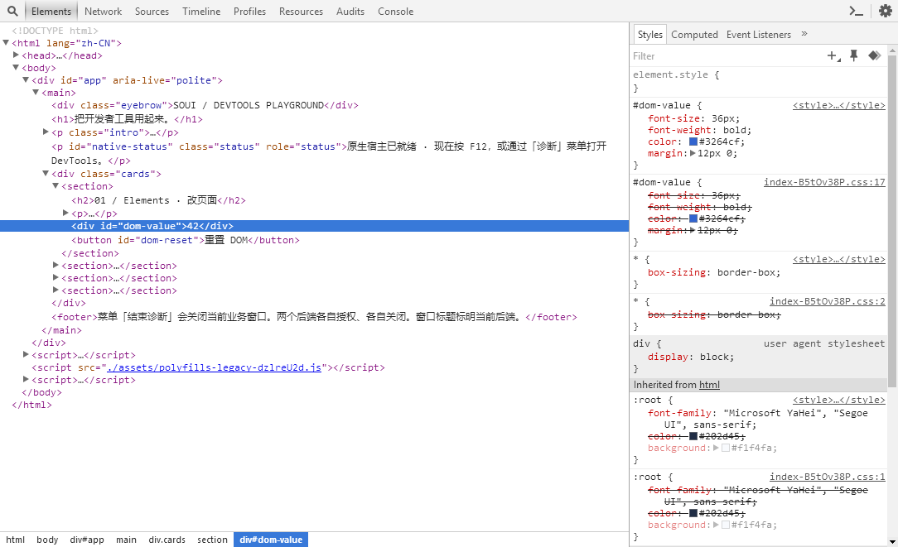
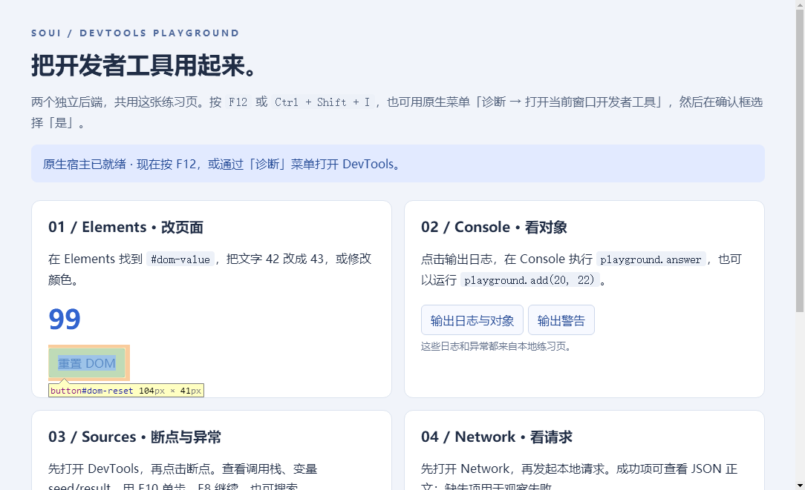

# MiniBlink Inspector 指针与元素拾取修复

日期：2026-11-03。PR 以前件 `ce9757e33e52ac680802691ff7e3a042eca86d52` 为基础，使用独立 checkout；原共享工作树及其他任务的改动未纳入提交。以下是局部源码回归和本地诊断载荷结果，不更新已发布 0.6.0 的验收结论。

## 问题与修复

1. Inspector 首文档提交进入业务文档切换规则，置 `documentPending=true` 并发布 `TypeNone`。Inspector 不接收业务 Host 上下文 ACK，导致进入窗口后指针消失。`brokerDocumentCommitted` 仅对“受控 Inspector、首个主文档、资源仍开放”保留初始已准入的身份，其他导航/关闭/业务规则不变。补丁为 `third_party/patches/miniblink/0015-inspector-initial-document-cursor.patch`。
2. 配对离线前端实际通过 raw `components/InspectElementModeController.js` → `sdk/DOMModel.js` → `DefaultDOMNodeHighlighter` 调用 `setInspectModeEnabled`。供应的命令表只声明新版 `DOM.setInspectMode`，内核 `InspectorBackendDispatcher`/`InspectorDOMAgent` 则实现旧命令。图标先变蓝，随后因方法未注册抛错，内核未启用拾取。`InspectorBackend.js` 在注册该新版声明时补齐旧命令签名，仍使用原参数检查、请求 ID、响应和错误回调；不扩展 native grant 或资源访问权限。

## 自动回归

从仓库根目录执行：

```powershell
node --test tests/sdk/devtools-frontend.test.cjs tests/sdk/devtools-frontend-package.test.cjs tests/sdk/devtools-package.test.cjs

cmake -S tests/native/devtools_cursor_document -B out/inspector-cursor-x64-sdk19041 -G "Visual Studio 17 2022" -A "x64,version=10.0.19041.0" -T "v143,host=x64,version=14.44.35207" "-DCMAKE_SYSTEM_VERSION=10.0.19041.0"
cmake --build out/inspector-cursor-x64-sdk19041 --config Release
ctest --test-dir out/inspector-cursor-x64-sdk19041 -C Release --output-on-failure

cmake -S tests/native/devtools_cursor_document -B out/inspector-cursor-x86-sdk19041 -G "Visual Studio 17 2022" -A "Win32,version=10.0.19041.0" -T "v143,host=x64,version=14.44.35207" "-DCMAKE_SYSTEM_VERSION=10.0.19041.0"
cmake --build out/inspector-cursor-x86-sdk19041 --config Release
ctest --test-dir out/inspector-cursor-x86-sdk19041 -C Release --output-on-failure

git apply --reverse --check third_party/patches/miniblink/0015-inspector-initial-document-cursor.patch
git diff --check
```

- Node：102 项，101 通过，1 项因系统不允许建立 fixture symlink 跳过，0 失败。新增协议回归先在旧覆盖源报 `agent.setInspectModeEnabled is not a function`；修复后启用、关闭、UA Shadow DOM 及错误原样回调通过，原隐私日志/合成/部署检查通过。
- 原生：MSVC v143 14.44.35207、Windows SDK 10.0.19041.0，x86/x64 Release 各 1 个 CTest 通过。测试抽取实际生产函数体，有限 fake 仅控制外部依赖，覆盖首文档、后续导航、关闭资源、业务文档、子 frame、重入代际变化及关闭/失败/错误线程，共九组；也接入 `SOUI_BUILD_VENDOR_TESTS`。此结果不等于完整内核重编或 DLL ABI 验证。
- 初次 standalone configure 的未固定 SDK 参数曾选中 10.0.26100.0；保留原目录，随后使用上述新目录和完整 generator platform 参数重做，生成项目明确固定 10.0.19041.0。这里只采用后者作为工具链约定结果。

## 本地 x64 窗口证据

环境：Windows 11 10.0.26200、x64 Release、本地独立 DevTools 练习应用。应用属于另一并行 Demo 请求，本 PR 不提交它。使用新隐藏 desktop、限定到自建进程的窗口消息输入和 PrintWindow，宿主 input desktop 保持 Default，不使用宿主 SendInput/SetCursorPos/SwitchDesktop。

内核来自本地源码重建；该共享源码的完整身份与本 PR 当前 main 前件不同。已核对本 PR 与实测内核所用的修复后 `brokerDocumentCommitted` 函数体逐字相同，其 UTF-8/LF SHA-256 为 `1c394c111e62d59b0d401bb179aa4e9a0b906513dac0d8335e4ae3cdf3baecfa`。不能据此宣称当前 main 的完整内核已重编。

| 输入 | SHA-256 |
|---|---|
| 本地 x64 `node.dll` | `0fed68af6712e8fdfd31e82281c7fe318f8fe6e25ab2f0b5274d1b2dcafc09d7` |
| 最终练习应用 EXE | `bf3dbc0d3189c89c7867faa2e72fb666cc8c333e715499f71e35a1bc8bcadbac` |
| 固定 650 成员供应基线 manifest | `2ecbd35cbc51c30efe97717c2fb8713fb032979b47286673cf70d2e6b1dcf7c2` |
| 本 PR 覆盖源 `source.json` | `21a7a124a864dabafedbbe14b6513233cd3623e51bd069e289da0e8302ba70b8` |
| 最终合成 frontend manifest | `a2f10b270e1b07ee527fa2229c1e387cc8d82a31d0f19da771c47aefe1958af7` |
| 最终 `InspectorBackend.js`（35090 字节） | `648bc2e7d573ced0d2f1e02aafa3a51ac9754492514a78665acf785b1ae911a0` |

前端通过正式合成与部署工具生成新目录、新清单和应用显式选择的本地技术配对记录。没有修改旧批准材料、旧清单或固定预编译 DLL；技术配对记录不表示签名、法律或发布批准。排查时使用的临时诊断显示已删除，最终源码及部署 JS 均不含该观测代码。

实际观察：

1. 按 F12、原生确认后连接 Elements；启用拾取并点击页面“42”，自动展开并选中 `div#dom-value`，样式面板显示其规则。
2. 在 Console 执行 `document.getElementById('dom-value').textContent='99';playground.add(20,22)`，返回 42，页面显示 99。
3. 再启用拾取，点击“重置 DOM”按钮，Elements 选中 `button#dom-reset`，页面值仍为 99；拾取点击未执行按钮动作。退出拾取后的普通点击恢复页面值 42。
4. 光标修复的独立 UI 线程探针在 Inspector hover/descriptor 后执行真实 WM_SETCURSOR 并读取 GetCursor。旧内核记录 3 次空指针；新内核观测 10 次，空指针 0 次、系统箭头 10 次。未单独验证文本 I-beam。PNG 不包含系统指针，不能由截图推断指针状态。探针不进入最终练习应用，也没有设置替代光标。
5. 最终应用同时打开业务与 Inspector 窗口后请求原生关闭，持有实际进程句柄观察其在 0.866 秒自然退出 0，没有强制结束。





后台验证输入需连续发送 move/move/down/up。MiniBlink 的鼠标离开定时器读取物理指针，分散的后台 move 可能每次都成为 MouseEnter 并被拾取逻辑忽略；初轮补命令后的离散输入没有选中节点，这个失败保留，不算通过，也没有为验证去禁用生产定时器。上面的最终结论来自连续移动后的真实 Elements 选中和页面状态。

## 剩余验证与回退

尚未重编当前 main 的完整 x86/x64 内核并运行全套 `Build-Dependencies.ps1`/`Test-Dependencies.ps1`，也未重做 Win7/Win8、DPI、多屏、硬件鼠标、长测和完整发布矩阵。x86 只有本次生产函数源码回归，不能当作新 x86 DLL 的交付证据。PR 保留为 draft，待完成当前主线的两架构内核验证；其余生产门槛仍按既有规则记录，不更新 `releaseReady` 或历史验收。

回退时撤回本 PR 源码提交，并在应用中选择原内核/前端/配对 pin 重新构建。已发布资产、`third_party/prebuilt`、旧许可和旧配对记录未被替换，无需覆盖它们。
