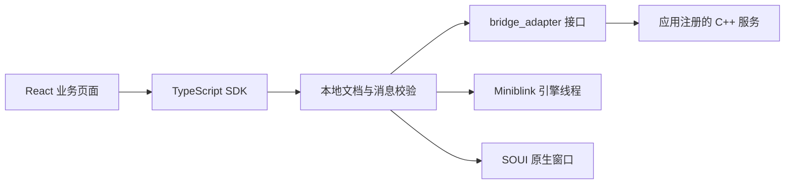

# 架构与所有权

## 三层交付

SDK 提供宿主运行、独立引擎线程、交互协议、Bridge、会话、权限、任务与 Web 客户端。模板选择最小页面和业务注册入口。完整 Demo 展示媒体与扫描等业务，不参与 SDK 编译。

`sdk/CMakeLists.txt` 直接生成 `soui_sdk.lib`，不包含任何模板或 Demo 文件。应用链接 `Soui::Sdk`。已安装的 SDK 包通过 CMake `find_package` 引入；它不依赖 SDK 的原始源码位置。

## 目录所有权

| 目录 | 维护责任 | 是否随 SDK 安装器更新 |
|---|---|---|
| `sdk/` | SDK 公共接口与实现 | 是 |
| `cmake/` | SDK 应用构建和部署规则 | 是 |
| `third_party/include,prebuilt,sources/zlib,licenses,manifests` | 固定的 SDK 依赖 | 是 |
| `tools/sdk,internal` 和 `tools/Build.ps1` | SDK 安装与构建工具 | 是 |
| 模板生成后的 `app,web,contracts,resources` | 产品业务团队 | 否 |
| `templates` | 模板维护者 | 不自动合并到已有项目 |
| `demos` | SDK 示例维护者 | 不复制到最小业务项目 |
| `third_party/sources/miniblink,soui` | 底层维护者 | 包含在完整源码包，避免每个新项目重复复制 |

## 扩展接口

`soui::sdk::bridge_adapter` 是应用与宿主的边界，宿主不依赖 Demo 的类型。简单应用使用 `json_bridge` 注册方法；复杂业务可以实现接口并复用 runtime 的授权和任务组件。`demos/workbench/integration` 展示完整异步任务实现。

UI、引擎与 Bridge worker 是不同线程。适配器必须比宿主存活更久；注册在启动前完成。运行期共享状态需要同步。关闭时先停止宿主，再释放适配器。导航切换撤销旧会话及其权限。

preview.3 开始由进程级 Runtime 统一持有 Miniblink 和引擎线程；每个 Host 独立持有 WebView、交互端点、Bridge worker 和会话。窗口销毁后仍可创建新窗口，最终应用退出另调用 `shutdown_miniblink_runtime()`。全局 JavaScript 绑定按执行上下文所属 WebView 路由到对应 adapter。设计、限制与验证要求见 [ADR-0003](adr/0003-process-runtime-ownership.md)。

模板和 Workbench 默认使用稳定的软件呈现路径。GPU compositor 仍可供内核专项实验，但当前关闭路径存在访问冲突，不能作为生产模板默认值；决策和复验边界见 [ADR-0005](adr/0005-stable-renderer-default.md)。

## 宿主适配器边界（preview.9）

通用配置、结果、适配器与宿主声明见 `sdk/include/soui/host/webview_host.h`。`webview_host` 为兼容宿主的通用别名，原有 `soui_miniblink_host.h` 和 `soui_miniblink_host` 接入继续保留。普通宿主控制、就绪查询和消息递送均通过适配器虚接口；未实现的可选控制操作返回 `E_NOT_SUPPORTED`。自定义适配器的真实转发与失败路径由 `sdk.native.host-adapter` 验证。

Miniblink 相关二进制配置和最终 Runtime 退出接口继续保留。公共 SDK 尚未安装 WebView2 后端；`experiments/webview2-consumer/` 单独验证 WebView2 适配器，其异步初始化先于同步挂载，设计见 [ADR-0013](adr/0013-experimental-webview2-consumer.md)。该接口提取不是跨平台或独立渲染进程声明。宿主 API 按窗口线程调用，适配器自己管理其引擎线程，不能从新接口推导任意并发安全。

能力发现由 `json_bridge` 的实际方法注册表提供，沿用会话授权。Web `describe/discover` 将可发现能力用于 UI/Agent 接入判断，不把示例类型表当成宿主安装清单。preview.10 增加下述动作与界面语义切片；完整 Agent 主体授权和后续工作见 [建设路线](roadmap/agent-gui-framework.md)。

preview.10 的动作契约是方法注册的可选元数据和原生校验边界，仍通过相同授权表发现及调用。文档能力白名单由C++配置并冻结。Web界面语义注册器独立于渲染器，将明确注册的节点动作连接到应用处理器；它不扫描整页、不伪造手势、不提供外部Agent身份。模板和WebView2实验接入相同问候业务，设计见 [ADR-0014](adr/0014-action-contracts-and-gui-semantics.md)。

## 编译与 ABI

当前是 C++17 静态源码 SDK，使用 MSVC v143、动态 Release CRT（包括带调试符号的 Debug 配置）。公开 C++ 类不是跨编译器稳定的 DLL ABI；应用、SDK 和接口宏必须使用一致的构建设置。CMake 导出携带必要的头文件、编译特性和系统链接库。

性能实验宏和测试注入宏不属于标准发行构建契约。标准 SDK 的目标、模板和 Demo 使用相同的公开类型布局。
