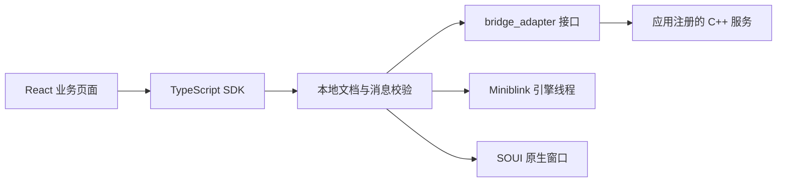

# 架构与所有权

开发分支可显式构建独立的 `Soui::Runtime` 无窗口子集，目标平台、头文件
交付边界与系统熵见 [跨平台说明](cross-platform.md) 和
[ADR-0122](adr/0122-portable-runtime-core.md)。独立 `Soui::Desktop` 的三系统
WebView 后端、统一 API 和实际验收边界见 [统一桌面入口](unified-desktop.md) 与
[ADR-0119](adr/0119-unified-system-webview-desktop.md)。以下 `Soui::Sdk` 说明仍适用
原 Windows 路径，其历史验收不能自动转移给新入口。

新入口的根 application 管理一个事件循环和至多 32 个活动窗口；子窗口独立
持有资源根、Bridge 授权和导航代际，所有业务回调按组串行。`close` 关闭当前窗，
`quit` 关闭整组；根析构撤销所有子窗口。原生菜单/托盘归属具体窗口而非网页，
细节见 [ADR-0120](adr/0120-managed-desktop-windows-and-native-actions.md)。

0.4 的可选现代适配器由 `sdk/renderers/webview2/` 持有，链接为 `Soui::WebView2`，通过公共 Host 和 Bridge 服务业务。基础 `Soui::Sdk` 默认不引入 Loader；现代模板由 `templates/modern-app/` 持有。环境策略与兼容应用共用 SDK，现代/兼容前端分别构建；具体边界见 [ADR-0016](adr/0016-runtime-profiles-and-modern-backend.md)。

## 三层交付

SDK 提供宿主运行、独立引擎线程、交互协议、Bridge、会话、权限、任务与 Web 客户端。模板选择最小页面和业务注册入口。完整 Demo 展示媒体与扫描等业务，不参与 SDK 编译。

`sdk/CMakeLists.txt` 直接生成 `soui_sdk.lib`，不包含任何模板或 Demo 文件。应用链接 `Soui::Sdk`。已安装的 SDK 包通过 CMake `find_package` 引入；它不依赖 SDK 的原始源码位置。

preview.9 的原生 `tray_service` 属于应用级桌面服务，由应用的隐藏顶层窗口及其线程持有，寿命独立于任一 Host/文档会话。服务不启动 WebView、不另起线程，也不决定最后业务窗口关闭后的进程策略。应用先明确移除托盘并销毁服务，再销毁其所有者窗口；详细状态和恢复边界见 [ADR-0012](adr/0012-public-tray-service.md)。

preview.10 增加同线程的 `menu_service` 和 `global_shortcut`，不向 Web 注入权限。Workbench 的显式 `--resident` 控制器持有这三项服务；三个业务槽位各有独立 adapter、Host、窗口和会话，共享进程 Runtime。SOUI 业务窗明确使用普通窗口类型，关闭请求延迟到控制器处理；销毁单窗不会自动结束消息循环。全部业务窗关闭后仍驻留，可由托盘菜单或 Ctrl+Alt+W 恢复；显式退出按菜单、快捷键、托盘、业务窗、Runtime、控制器顺序清理。默认单窗方式保留。实现与验证边界见 [ADR-0013](adr/0013-public-menu-shortcut-and-residency.md)。

## 目录所有权

preview.11 将文档的稳定授权身份与访问令牌分开。原生 `permission_store` 管理不可扩大的能力集、令牌轮换和撤销；`bridge_transport` 只把本次验证得到的 scope 传给处理器。公共任务、目录扫描与 Demo 资源归属保留 scope，轮换不会更换 Host 文档代际、任务或订阅。关闭先撤销，再在各资源锁下回收，资源提交在自己的锁内检查授权，权限锁不跨业务回调和工作线程 join。Web 连接器在同一客户端内续期，业务调用仍同步进入原生绑定以保留输入手势。详见 [ADR-0014](adr/0014-same-document-session-renewal.md)。

| 目录 | 维护责任 | 是否随 SDK 安装器更新 |
|---|---|---|
| `sdk/` | SDK 公共接口与实现 | 是 |
| `cmake/` | SDK 应用构建和部署规则 | 是 |
| `third_party/include,prebuilt,sources/zlib,licenses,manifests` | 固定的 SDK 依赖 | 是 |
| `tools/sdk,internal` 和 `tools/Build.ps1` | SDK 安装与构建工具 | 是 |
| 模板生成后的 `app,web,contracts,resources` | 产品业务团队 | 否 |
| `templates` | 模板维护者 | 不自动合并到已有项目 |
| `demos` | SDK 示例维护者 | 不复制到最小业务项目 |
| `third_party/sources/miniblink,soui` | 底层维护者 | 包含在完整源码包，避免每个新项目重复复制 |

## 扩展接口

preview.13 的源码 SDK 安装器使用项目内独占事务、完整备份和不可变 journal，锁文件发布作为提交点。进程重启后根据锁与载荷判断完成提交或恢复旧版本，遇到未知内容不覆盖。安装恢复与运行期 Runtime/Host 生命周期无关，设计见 [ADR-0015](adr/0015-restartable-sdk-installation.md)。

`soui::sdk::bridge_adapter` 是应用与宿主的边界，宿主不依赖 Demo 的类型。简单应用使用 `json_bridge` 注册方法；复杂业务可以实现接口并复用 runtime 的授权和任务组件。`demos/workbench/integration` 展示完整异步任务实现。

UI、引擎与 Bridge worker 是不同线程。适配器必须比宿主存活更久；注册在启动前完成。运行期共享状态需要同步。关闭时先停止宿主，再释放适配器。导航切换撤销旧会话及其权限。

preview.3 开始由进程级 Runtime 统一持有 Miniblink 和引擎线程；每个 Host 独立持有 WebView、交互端点、Bridge worker 和会话。窗口销毁后仍可创建新窗口，最终应用退出另调用 `shutdown_miniblink_runtime()`。全局 JavaScript 绑定按执行上下文所属 WebView 路由到对应 adapter。设计、限制与验证要求见 [ADR-0003](adr/0003-process-runtime-ownership.md)。

模板和 Workbench 默认使用稳定的软件呈现路径。GPU compositor 仍可供内核专项实验，但当前关闭路径存在访问冲突，不能作为生产模板默认值；决策和复验边界见 [ADR-0005](adr/0005-stable-renderer-default.md)。

## 宿主适配器边界（preview.9）

0.5 应用退出把 Host 关闭与 Runtime 关闭分开：兼容模板和 Workbench 在所有 Host 销毁后，以二十秒总预算等待非阻塞 Miniblink 关闭；Modern 模板独占自己的持久 profile，Controller 关闭后继续持有 adapter、Bridge、窗口消息循环和 Runtime exit watch，直到实际退出事件、进程信号及回调收尾完成。详情和失败边界见 [ADR-0094](adr/0094-application-runtime-shutdown.md)。

通用配置、结果、适配器与宿主声明见 `sdk/include/soui/host/webview_host.h`。`webview_host` 为兼容宿主的通用别名，原有 `soui_miniblink_host.h` 和 `soui_miniblink_host` 接入继续保留。普通宿主控制、就绪查询和消息递送均通过适配器虚接口；未实现的可选控制操作返回 `E_NOT_SUPPORTED`。自定义适配器的真实转发与失败路径由 `sdk.native.host-adapter` 验证。

Miniblink 相关二进制配置和最终 Runtime 退出接口继续保留。公共 SDK 通过可选 `Soui::WebView2` 安装现代适配器，其异步初始化先于同步挂载。早期 `experiments/webview2-consumer/` 保留实验来源；当前交付与初始化契约见 [ADR-0016](adr/0016-runtime-profiles-and-modern-backend.md)和[现代后端](modern-backend.md)。该接口提取不是跨平台或独立渲染进程声明。宿主 API 按窗口线程调用，适配器自己管理其引擎线程，不能从新接口推导任意并发安全。

能力发现由 `json_bridge` 的实际方法注册表提供，沿用会话授权。Web `describe/discover` 将可发现能力用于 UI/Agent 接入判断，不把示例类型表当成宿主安装清单。preview.10 增加下述动作与界面语义切片；0.5 的本地 Agent 端点由应用在原生侧显式创建和授权，调用复用同一 Bridge 的动作与任务服务，见 [ADR-0046](adr/0046-windows-local-agent-endpoint.md)。可选 `Soui::Uia` 由独立的 HWND owner 控制器发布公开状态和调度允许的业务动作，不把桌面 UIA 访问转换为 Agent 授权，见 [ADR-0047](adr/0047-finite-windows-uia-provider.md)。后续范围与验收见 [建设路线](roadmap/agent-gui-framework.md)。

preview.10 的动作契约是方法注册的可选元数据和原生校验边界，仍通过相同授权表发现及调用。文档能力白名单由C++配置并冻结。Web界面语义注册器独立于渲染器，将明确注册的节点动作连接到应用处理器；它不扫描整页、不伪造手势、不提供外部Agent身份。模板和WebView2实验接入相同问候业务，设计见 [ADR-0014](adr/0014-action-contracts-and-gui-semantics.md)。

## 编译与 ABI

当前是 C++17 静态源码 SDK，使用 MSVC v143、动态 Release CRT（包括带调试符号的 Debug 配置）。公开 C++ 类不是跨编译器稳定的 DLL ABI；应用、SDK 和接口宏必须使用一致的构建设置。CMake 导出携带必要的头文件、编译特性和系统链接库。

性能实验宏和测试注入宏不属于标准发行构建契约。标准 SDK 的目标、模板和 Demo 使用相同的公开类型布局。

