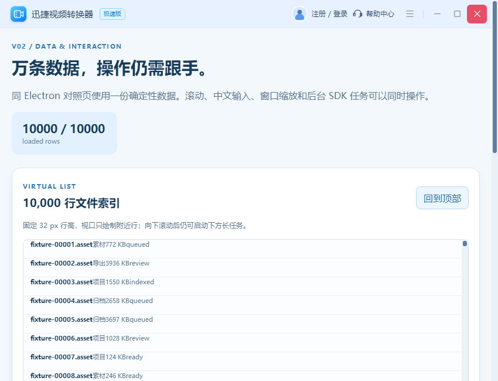

# Workbench 滚动条：当前构建的本机显示检查

截图中的外层页面滚动条与 V02 万行列表滚动条原先沿用 Win7/旧 Miniblink 的默认外观。本分支只给 React Workbench 增加 Chrome 49 可识别的 `::-webkit-scrollbar` 轨道、滑块和按钮样式；SDK Core、滚动逻辑及受信 Bridge 均未改变。

正式 `tools/Build.ps1` 在 x64 Release 完整 Web 构建、x86 Release `-SkipWeb` 构建均原始退出 0。两架构的 `source.sha256` 都是 `33adadfc3643208c05c27f7ac28c430175d9dcc5be69e254ea8796f8c711dd09`，构建 ID 分别为 `d552447a-5327-4a53-9b85-fdfd5a260608` 和 `111abe32-bfed-42aa-ae9c-80dcb3ba2f6e`。Workbench 载荷 SHA-256 分别为 `c539ec980f3b8ddef67d10c78a418ef4e5a0cf5164d03fae3701166fe857bbde` 和 `602076612c8fc6823921a6ab0570d2bb2b160c64acae8535c4c335f95c1513d6`。外部原始构建日志保留；其 SHA-256 分别为 `1abe9fd90352794c55ced965cefd64c67f646ff0d81c1dbcb4884a1eb2e1607d` 和 `90fca9d141a8799fe69210eda3fc86922374b600c73979d68014e35b2eb97125`。`raw/build/` 保存完整构建身份与载荷清单。

第一次 x64 可视探针要求应用自然取得前台；真实前台属于其他进程，因此原始退出 1，没有截图。该次应用本身退出 0，失败原样本保存在 `raw/x64-foreground-refusal/`。随后不抢前台，分别对 x64、x86 的真实 Workbench 窗口使用 `PrintWindow` 截图。两次探针原始退出 0，目标窗口 PID/HWND 与截图散列已记录，窗口正常关闭、应用退出 0、EXE 前后散列一致；实时门禁没有发现外部桌面负载。人工检查两张原图：页面最右侧和列表内侧均呈窄轨道、蓝灰色滑块，没有旧式上下箭头。截图与原始结果在 `raw/x64-visual/` 和 `raw/x86-visual/`，`Verify-Evidence.cjs` 对构建、源码 CSS、截图、原始结果和外部原件的只读核对退出 0。




这些本机截图只证明当前 x86/x64 构建的静态外观和正常关闭。尚未在 Win7 SP1 x86 运行本次新载荷，也未重新验收滚轮、拖动、键盘输入、中文 IME、DPI、多屏、30 秒任务并行或长稳；此前 Win7 截图不能继承为本分支的通过证据。`win7CurrentV02Verified=false`、`benchmarkValid=false`、`releaseReady=false`。

从仓库根目录执行只读复核：

```powershell
node verification/production-validation/scrollbar-style-modern-2026-09-29/Verify-Evidence.cjs
```
